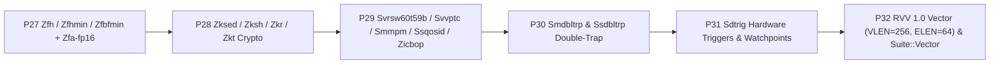

# Rivemu & Rivemu-Lockstep Follow-Up Plan (P27–P32)

> **Status: COMPLETED (P27–P32).** All six follow-up milestones (**P27–P32**) are implemented, unit-tested, and verified in differential lockstep against Sail 0.16 and `qemu-system-riscv64`.
> **Baseline:** Milestones **P0–P26** are complete and committed in [`qemu_rust`](../README.md) (`4e83a03`) and [`rivemu-lockstep`](../../rivemu-lockstep/README.md) (`3a87bf3`).
> This follow-up plan defines the next six milestones (**P27–P32**) covering IEEE-754 half-precision & BFloat16 floating-point, ShangMi cryptography & entropy source CSRs, RVA23 virtual-memory/QoS refinements, double-trap protection, architectural debug triggers (`Sdtrig`), and the RISC-V Vector 1.0 (`V`) extension.

---

## P27 – Half-Precision & BFloat16 Floating-Point (`Zfh`, `Zfhmin`, `Zfbfmin`) and `Zfa` Half-Precision

### Scope (`rivemu-softfloat` & `rivemu-cpu-riscv`)
- **`rivemu-softfloat` (`f16` & `bf16`):**
  - Implement exact IEEE-754 binary16 (`f16`) arithmetic (`add_f16`, `sub_f16`, `mul_f16`, `div_f16`, `sqrt_f16`, `fma_f16`), comparisons (`eq_f16`, `lt_f16`, `le_f16`, quiet `ltq_f16`/`leq_f16`), `min_f16`/`max_f16`/`minm_f16`/`maxm_f16`, `round_to_int_f16`, `classify_f16`, and conversions (`f16` $\leftrightarrow$ `f32`/`f64`/`i32`/`u32`/`i64`/`u64`) with tininess-after-rounding and canonical NaN (`0x7e00`).
  - Implement `Zfbfmin` conversions (`fcvt.bf16.s` and `fcvt.s.bf16`) with 16-bit NaN-boxing (`0xffff_ffff_ffff_0000 | bits16`).
- **`rivemu-cpu-riscv` (`decode.rs`, `hart.rs`, `fdt.rs`):**
  - Decode and execute `flh` / `fsh`, `fmt = 0b10` (`H`) R-type and R4-type FP instructions, and `Zfa` half-precision operations (`fli.h`, `fminm.h`, `fmaxm.h`, `fround.h`, `froundnx.h`, `fleq.h`, `fltq.h`).
  - Advertise `zfh`, `zfhmin`, `zfbfmin` in `rivemu-machine/src/fdt.rs`.

### Verification (`rivemu-lockstep`)
- Extend `Suite::Float` and `Suite::FpEdges` with `Zfh`, `Zfhmin`, `Zfbfmin`, and `Zfa` half-precision cases (including 16-bit NaN-boxing in 64-bit `f` registers) and verify 0 divergences against Sail 0.16 and `qemu-system-riscv64` (`zfh=true,zfhmin=true,zfbfmin=true`).

---

## P28 – ShangMi Scalar Cryptography (`Zksed`, `Zksh`), Entropy Source (`Zkr`), and `Zkt`

### Scope (`rivemu-cpu-riscv`)
- **`Zksed` (SM4 Block Cipher):**
  - `sm4ed rd, rs1, rs2, bs` (`opcode=0x33, f3=0, f7=(bs << 5) | 0b11000`): SM4 S-box and linear transformation $L(B) = B \oplus (B \lll 2) \oplus (B \lll 10) \oplus (B \lll 18) \oplus (B \lll 24)$, sign-extended from 32 bits to 64 bits.
  - `sm4ks rd, rs1, rs2, bs` (`opcode=0x33, f3=0, f7=(bs << 5) | 0b11010`): SM4 S-box and key-schedule linear transformation $L'(B) = B \oplus (B \lll 13) \oplus (B \lll 23)$, sign-extended from 32 bits to 64 bits.
- **`Zksh` (SM3 Hash Function):**
  - `sm3p0 rd, rs1` (`opcode=0x13, f3=1, imm12=0x108`): $P_0(x) = \text{sext32}(x \oplus (x \lll_{32} 9) \oplus (x \lll_{32} 17))$.
  - `sm3p1 rd, rs1` (`opcode=0x13, f3=1, imm12=0x109`): $P_1(x) = \text{sext32}(x \oplus (x \lll_{32} 15) \oplus (x \lll_{32} 23))$.
- **`Zkr` (Entropy Source CSR `seed` `0x015`) & `Zkt`:**
  - Implement read-write CSR `seed` (`0x015`) returning `OPST = ES16 (0b10 << 30)` with deterministic PRNG entropy in bits `[15:0]` when written, gated in S-mode by `mseccfg.SSEED` (bit 9) and in U-mode by `mseccfg.USEED` (bit 8).
  - Advertise `zksed`, `zksh`, `zkr`, `zkt` in `rivemu-machine/src/fdt.rs`.

### Verification (`rivemu-lockstep`)
- Expand `Suite::Crypto` (`gen_crypto`) with `sm4ed`, `sm4ks`, `sm3p0`, and `sm3p1` and `Suite::CsrTrap` / `Suite::Privileged` with `mseccfg.SSEED`/`USEED` gating of `seed` (`0x015`) against Sail 0.16 and QEMU (`zksed=true,zksh=true,zkr=true,zkt=true`).

---

## P29 – RVA23 Virtual Memory, Pointer Masking & QoS Refinements (`Svrsw60t59b`, `Svvptc`, `Smmpm`, `Ssqosid`, `Zicbop`)

### Scope (`rivemu-cpu-riscv`)
- **`Svrsw60t59b` (PTE Software-Reserved Bits `[60:59]`):**
  - Update `pte::RESERVED_HIGH_MASK` in `crates/rivemu-cpu-riscv/src/mmu.rs` so bits `[60:59]` of leaf and non-leaf PTEs are ignored by hardware page-table walks and available for OS software use (mandated by RVA23S64).
- **`Svvptc` (Obviating Memory-Management Instructions after Marking PTEs Valid):**
  - Ensure invalid translations are never cached in `Tlb`, and advertise `svvptc` + `svrsw60t59b` in `rivemu-machine/src/fdt.rs`.
- **`Smmpm` (M-Mode Pointer Masking):**
  - Enforce `mseccfg.PMM` (bits `[33:32]`) on M-mode data loads/stores/AMOs even when `mstatus.MPRV == 0`.
- **`Ssqosid` (Quality-of-Service Identifiers):**
  - Implement `srmcfg` CSR (`0x181`, 12-bit `RCID` in bits `[11:0]` and 12-bit `MCID` in bits `[27:16]`), gated in S-mode by `mstateen0.SRMCFG` (bit 55).
- **`Zicbop` (Cache-Block Prefetch Hints):**
  - Decode `prefetch.i`, `prefetch.r`, and `prefetch.w` (`ori x0, rs1, imm12` with `imm12[4:0] == 0..=3`) as architectural no-ops and advertise `zicbop` in `fdt.rs`.

### Verification (`rivemu-lockstep`)
- Add `Svrsw60t59b` PTE bit `[60:59]` test cases to `Suite::Sv48`, `Smmpm` M-mode pointer masking to `Suite::Cfi`, and `srmcfg` / `mstateen0.SRMCFG` to `Suite::CsrTrap`, verified against Sail 0.16 and QEMU.

---

## P30 – Double-Trap Architecture (`Smdbltrp`, `Ssdbltrp`)

### Scope (`rivemu-cpu-riscv`)
- **CSR State (`csr.rs`, `hart.rs`):**
  - Add `mstatus.MDT` (bit 42) and `mstatus.SDT` / `sstatus.SDT` (bit 24), plus `menvcfg.DTE` (bit 59).
  - On trap entry to S-mode when `menvcfg.DTE == 1`:
    - If `sstatus.SDT == 1`, redirect the trap to M-mode as a **Double Trap** exception (`cause = 16`, `mtval2` / `tval = 0`) instead of entering S-mode!
    - Otherwise set `sstatus.SDT = 1` and clear `sstatus.SIE = 0`.
  - Writing `mstatus.MDT = 1` or `sstatus.SDT = 1` automatically clears `mstatus.MIE = 0` or `sstatus.SIE = 0` per the `Smdbltrp`/`Ssdbltrp` specification.
  - `MRET` clears `mstatus.MDT = 0`; `SRET` (and `MRET` to S/U-mode) clears `sstatus.SDT = 0`.

### Verification (`rivemu-lockstep`)
- Add directed `Ssdbltrp` / `Smdbltrp` test cases in `Suite::Privileged` verifying `SDT`/`MDT` auto-clearing of `SIE`/`MIE`, `SRET`/`MRET` clearing of `SDT`/`MDT`, and S-mode double-trap escalation (`mcause = 16`) against QEMU (`smdbltrp=true,ssdbltrp=true`).

---

## P31 – Debug Trigger Module (`Sdtrig`: Hardware Breakpoints & Watchpoints)

### Scope (`rivemu-cpu-riscv` & `rivemu-gdbstub`)
- **Trigger CSRs (`csr.rs`, `hart.rs`, `mmu.rs`):**
  - Implement 4 hardware triggers (`tselect` `0x7a0`, `tdata1` `0x7a1`, `tdata2` `0x7a2`, `tdata3` `0x7a3`, `tinfo` `0x7a4`, `scontext` `0x5a8`, `mcontext` `0x7a8`) gated by `mstateen0.CONTEXT` (bit 57).
  - Support `mcontrol6` (`type = 6`) execute, load, and store address triggers (`action = 0` breakpoint exception `cause = 3` with `tval = addr`), plus `icount` (`type = 3`) single-step triggers.
  - Only check active triggers when a per-hart `active_trigger_mask != 0` flag is set so zero-trigger execution has zero overhead on the fast path.
- **GDB Stub Watchpoint Integration (`rivemu-gdbstub`):**
  - Wire GDB RSP `Z2`/`z2` (write watchpoint), `Z3`/`z3` (read watchpoint), and `Z4`/`z4` (access watchpoint) packets into the hart's `mcontrol6` triggers.

### Verification (`rivemu-lockstep`)
- Add `Sdtrig` unit and lockstep tests verifying `tselect`/`tdata1`/`tdata2`/`tinfo` WARL semantics and `mcontrol6` load/store/execute breakpoint traps against Sail 0.16 and QEMU.

---

## P32 – RISC-V Vector Extension (`RVV 1.0` / `V`, `VLEN = 256`, `ELEN = 64`) & `Suite::Vector`

### Scope (`rivemu-cpu-riscv` & `rivemu-lockstep`)
- **Vector Architectural State (`hart.rs`, `csr.rs`, `snapshot.rs`):**
  - 32 $\times$ 256-bit (`[u8; 32]`) vector registers `v0..v31` (`VLEN = 256`, `ELEN = 64`, `vlenb = 32`).
  - Vector CSRs: `vstart` (`0x008`), `vxsat` (`0x009`), `vxrm` (`0x00a`), `vcsr` (`0x00f`), `vl` (`0xc20`), `vtype` (`0xc21`), `vlenb` (`0xc22`), and `mstatus.VS` (bits `[10:9]`).
- **Configuration & Memory Operations:**
  - `vsetvli`, `vsetivli`, `vsetvl` (`SEW = 8/16/32/64`, `LMUL = 1/8..8`, `vta`, `vma`, `vill` legal/reserved handling).
  - Unit-stride, strided, indexed (unordered/ordered), whole-register (`vl1r`..`vl8r` / `vs1r`..`vs8r`), and mask (`vlm.v` / `vsm.v`) loads and stores with fault-only-first (`vle*ff.v`) support.
- **Vector Integer, Mask, Permute & Floating-Point Operations:**
  - Integer ALU (`vadd`, `vsub`, `vrsub`, `vand`, `vor`, `vxor`, `vsll`, `vsrl`, `vsra`, `vmin*`, `vmax*`, `vmul*`, `vdiv*`, `vrem*`, widening & narrowing, fixed-point saturation).
  - Mask logical (`vmand*`, `vmor*`, `vmxor*`, `vcpop.m`, `vfirst.m`, `vmsbf.m`, `vmsif.m`, `vmsof.m`, `viota.m`, `vid.v`), reductions (`vredsum`, `vredmax*`, `vredmin*`, `vredand`, `vredor`, `vredxor`), slides/gathers (`vslideup`, `vslidedown`, `vslide1up`, `vslide1down`, `vrgather`, `vcompress`), and scalar moves (`vmv.x.s`, `vmv.s.x`).
  - Vector floating-point (`vfadd`, `vfsub`, `vfmul`, `vfdiv`, `vfsqrt`, `vfmacc*`, `vfcvt*`, `vfred*`) reusing `rivemu-softfloat`.
- **`Suite::Vector` (`rivemu-lockstep`):**
  - Extend `ArchState` (or add vector register comparison for `Suite::Vector`) and verify randomized & directed RVV 1.0 instruction blocks against Sail 0.16 and `qemu-system-riscv64` (`v=true,vlen=256,elen=64`).
