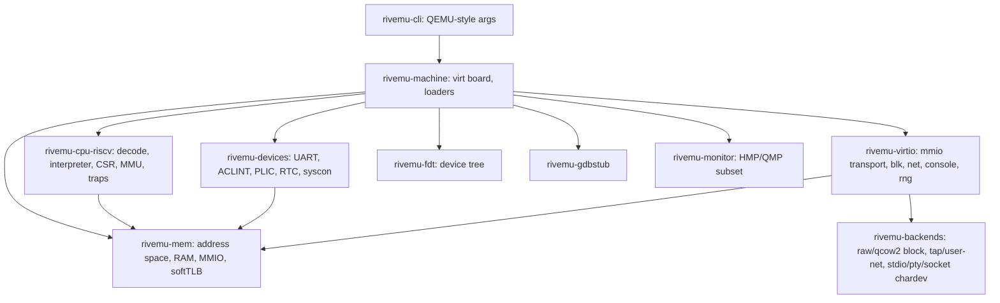
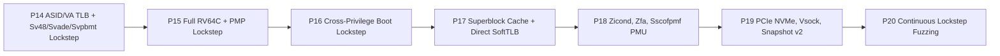

# Plan: `rivemu` – a limited, pure-Rust QEMU successor (emulation only)

> Implementation checkboxes and exit evidence are tracked separately. See
> [`VALIDATION_STATUS.md`](VALIDATION_STATUS.md) for the current verification
> matrix and outstanding work.

## 1. Locked Decisions

| Area | Decision |
|---|---|
| Mode | Full-system emulation only (no user-mode, no KVM/HVF) |
| Guest ISA | RISC-V **RV64GC** (IMAFDC + Zicsr + Zifencei), M/S/U modes, Sv39/Sv48 |
| Host platforms | macOS arm64, Linux x86_64/arm64 |
| Execution engine | **Interpreter only** – optimised with a decoded-block cache (no JIT, no runtime codegen) |
| Machine | Single board: `virt`, memory map compatible with QEMU's `riscv64 virt` |
| Firmware | Upstream **OpenSBI** binary (`fw_dynamic`/`fw_jump`) loaded as guest firmware; emulator itself is 100% Rust |
| CLI | QEMU-compatible subset, binary name `rivemu-system-riscv64` |
| Unsafe policy | `unsafe` only in `rivemu-mem` (guest RAM host pointers / mmap) |
| Non-goals | JIT, user-mode, KVM, live migration, graphics, PCI (initially), multiple boards/ISAs |

**Success criterion:** `rivemu-system-riscv64 -M virt -nographic -bios fw_jump.bin -kernel Image -initrd rootfs.cpio -append "console=ttyS0"` boots upstream Linux to a BusyBox shell; a disk-image distro (Alpine/Debian riscv64) boots with virtio-blk root and virtio-net networking. Performance target: Linux-to-shell (initramfs) in **< 60 s** on an M-series Mac.

## 2. Architecture



### Cargo workspace
```
rivemu/ (github.com/kmehltretter82/rivemu)
  Cargo.toml                 workspace
  crates/
    rivemu-core/        GuestAddr, AccessSize, Exception/Interrupt types, virtual clock, IRQ line trait
    rivemu-mem/         AddressSpace, region map, mmap'd RAM, MmioDevice trait, dirty-page tracking
    rivemu-cpu-riscv/   decoder, instruction handlers, block cache, CSRs, MMU walker + softTLB, softfloat glue
    rivemu-devices/     ns16550a, ACLINT (mtimer/mswi/sswi), PLIC, goldfish-rtc, sifive_test/syscon
    rivemu-virtio/      virtio-mmio v2, split virtqueue; blk, net, console, rng
    rivemu-backends/    block (raw, qcow2 subset), net (tap Linux, user-net via smoltcp, vmnet later), chardev
    rivemu-fdt/         FDT builder (QEMU virt-compatible nodes)
    rivemu-gdbstub/     wrapper over `gdbstub` crate
    rivemu-monitor/     minimal HMP (stdio mux Ctrl-A) + QMP JSON (quit, stop, cont, query-status, system_powerdown)
    rivemu-machine/     virt board wiring, ELF/raw/initrd loaders, reset, main loop
    rivemu-cli/         `rivemu-system-riscv64` binary
  tests/            riscv-tests runner, Linux boot smoke tests
  images/           (gitignored) fetched kernel/OpenSBI/rootfs test artifacts + fetch script
```

### Interpreter design (performance without JIT)
- **Decoded-block cache:** guest code is decoded once into blocks of pre-decoded instructions (`enum Insn` with operand fields resolved, or a `fn` pointer + packed operands). Keyed by guest physical PC + privilege mode; ends at branches, CSR writes affecting translation, or page boundary.
- **Fast dispatch:** tight `match` over a compact op enum (Rust compiles to a jump table); hot paths like `addi`, loads/stores and branches get special-cased variants (e.g. `addi rd, x0, imm` → `Li`).
- **SoftTLB:** per-hart direct-mapped TLB (separate read/write/exec), entry stores host pointer offset → RAM access is one compare + one load. MMIO and misses take the slow path.
- **Self-modifying code:** decoded caches are generation-tagged and invalidated by guest `fence.i` and SBI remote-fence handling; stores rely on the guest's architectural instruction-stream synchronization.
- **Interrupt checks** only at block boundaries (plus pending-flag on `wfi`/CSR writes).
- **Timekeeping:** `mtime` derived from host monotonic clock (default) or instruction count (`-icount` deterministic mode, useful for tests).

### Threading
- Phase 1: single vCPU thread runs all harts round-robin (deterministic, simple).
- Phase 2: optional thread-per-hart (MTTCG-like) with host atomics for AMO/LR-SC.
- One I/O thread with an event loop (`polling`) for chardev/net/block backends; communicates with devices through lock-protected queues + IRQ notifications.

### CLI subset (QEMU-compatible)
`-M/-machine virt`, `-m`, `-smp`, `-bios`, `-kernel`, `-initrd`, `-append`, `-dtb`, `-drive file=,format=,if=none,id=`, `-device virtio-blk-device,drive=`, `-netdev user|tap,id=`, `-device virtio-net-device,netdev=`, `-nographic`, `-serial`, `-chardev`, `-monitor`, `-qmp`, `-s`/`-gdb`, `-S`, `-d` (in_asm, int, mmu, guest_errors), `-D`, `-icount`, `-no-reboot`. Unknown options → clear error message.

## 3. Roadmap


### P0 – Skeleton (≈1 week)
- Workspace, CI (macOS arm64 + Linux x86_64): `cargo test`, `clippy -D warnings`, `rustfmt --check`, `cargo-deny`.
- `rivemu-core`, `rivemu-mem` (RAM + MMIO dispatch), ELF loader, CLI parser skeleton accepting the QEMU option syntax.
- **Exit:** address-space unit tests green; `rivemu-system-riscv64 --help` works.

### P1 – RV64GC unprivileged interpreter (≈3 weeks)
- Decoder incl. compressed (C) instructions; RV64I/M/A/F/D, Zicsr, Zifencei.
- F/D with exact IEEE semantics (rounding modes, fflags, NaN-boxing) via a pure-Rust softfloat (e.g. `simple-soft-float`/own port of Berkeley SoftFloat).
- Straightforward fetch-decode-execute first; HTIF `tohost` for test exit.
- **Exit:** all `riscv-tests` `rv64u{i,m,a,f,d,c}-p-*` pass.

### P2 – Privileged architecture & MMU (≈3 weeks)
- M/S/U modes, trap delegation, `mret/sret/wfi`, `mstatus` fields (MPRV, SUM, MXR, FS), counters, minimal PMP.
- Sv39/Sv48 walker with A/D updates, `sfence.vma`, softTLB.
- Interrupt delivery (`mip/mie/mideleg`), Sstc (`stimecmp`) for faster Linux timers.
- **Exit:** `rv64{mi,si}-p-*` and `rv64*-v-*` riscv-tests pass; riscv-arch-test privileged subset green.

### P3 – `virt` board & Linux boot (≈3 weeks)
- Devices: ns16550a, ACLINT, PLIC, sifive_test (poweroff/reboot), goldfish RTC.
- FDT generation (or `-dtb`), OpenSBI + kernel + initrd placement identical to QEMU, `a0/a1` boot protocol, fw_dynamic info struct.
- Decoded-block cache + softTLB fast paths.
- gdbstub (`-s -S`), `-d int,guest_errors` logging.
- **Exit:** upstream Linux defconfig + BusyBox initramfs boots to shell; `poweroff` and `reboot` work; boot test runs in CI.

### P4 – Virtio & host backends (≈3 weeks)
- virtio-mmio v2 transport, split virtqueues, event-idx.
- virtio-blk (raw, then qcow2 read/write subset), virtio-net (user-net via `smoltcp` with DHCP/DNS/port-forward `hostfwd`; tap on Linux), virtio-console, virtio-rng.
- Chardev backends: stdio (with Ctrl-A mux), pty, unix/tcp socket; monitor + QMP subset.
- **Exit:** Alpine/Debian riscv64 disk image boots to login, package install over network succeeds.

### P5 – Performance, SMP, polish (≈3–4 weeks, then ongoing)
- Profiling (`perf`/Instruments), op fusion in block cache, branch-target block chaining, reducing bounds checks in hot paths.
- `-smp N`: round-robin first, then thread-per-hart; IPIs via ACLINT/SBI; correct AMO/LR-SC.
- Optional: CPU+device snapshot (`savevm`-lite via `serde`), packed virtqueues, vmnet on macOS.
- **Exit:** < 60 s initramfs boot; `-smp 4` Linux boot stable; benchmark suite tracked per commit.

Total for P0–P5: roughly **4 months** for one developer.

## 4. Testing & Verification
- **Unit tests** per crate (decoder tables, CSR rules, page walks, virtqueue parsing, CLI parsing).
- **Conformance:** `riscv-tests`, `riscv-arch-test` (reference signatures from Sail/Spike).
- **Differential testing:** compare instruction traces with Spike / QEMU (`-d exec,cpu`) on small programs; `cargo-fuzz` on the decoder and single-instruction execution vs Spike.
- **Integration:** expect-style Linux boot tests in CI with prebuilt kernel/OpenSBI/rootfs fetched by `images/fetch.sh` (cached).
- **Benchmarks:** `criterion` micro-benchmarks, guest CoreMark/Dhrystone, boot-time measurement.

## 5. Dependencies (all pure Rust)
`clap` (or hand-written parser for QEMU syntax), `goblin`/`object`, `memmap2`, `gdbstub`, `vm-fdt`, `smoltcp`, `polling`, `serde`/`serde_json`, `tracing`, `thiserror`/`anyhow`, softfloat crate. Dev: `criterion`, `cargo-fuzz`.

## 6. Risks
| Risk | Mitigation |
|---|---|
| Interpreter too slow for the 60 s target | Block cache + softTLB early (P3), profile continuously, op fusion |
| FP edge cases | Softfloat for all F/D ops, arch-test coverage |
| QEMU CLI quirks (`-drive`/`-netdev` option syntax) | Dedicated parser for QEMU `key=value,...` grammar with tests from real-world scripts |
| macOS networking without root | user-net (smoltcp) as default backend; vmnet optional later |
| Scope creep | Non-goals list above; one board, one ISA |

## 7. Progress
- [x] **P0** – workspace, CI, `rivemu-core`, `rivemu-mem`, loaders, CLI skeleton
- [x] **P1** – RV64GC interpreter, `rivemu-softfloat` (exact IEEE, all rounding modes)
- [x] **P2** – M/S/U, traps/delegation, Sv39/Sv48 + TLB, Sstc; all 244 riscv-tests (`-p` and `-v`) pass
- [x] **P3** – `virt` board (UART, CLINT, PLIC, RTC, sifive_test), `rivemu-fdt`, icache + fast RAM, `rivemu-gdbstub`, `-d`/`-D` logging, Linux + BusyBox shell boot (< 18 s on M-series Mac)
- [x] **P4** – `rivemu-virtio` (`virtio-mmio` v2, split virtqueues, `blk`, `net`, `console`, `rng`), `rivemu-backends` (raw/qcow2 block, user-mode network stack with ARP/DHCP/ICMP/DNS/TCP/UDP + `hostfwd`, chardev), `rivemu-monitor` (HMP + QMP JSON)
- [x] **P5** – SMP (`-smp 4` Linux boot in ~19.9 s), host atomics (`lr`/`sc`/`amo` + `pause`/IPI slice yielding), deterministic `-icount` timebase with idle timer warping, full documentation & test suite
- [x] **P6** – Built-in pure-Rust SBI v2.0 handler (`-bios none` / `-bios builtin`), S-mode ELF direct boot, symbolicated fault backtraces (`.symtab`), `-d sbi`, and RISC-V Semihosting (`ebreak` magic sequence)
- [x] **P7** – `rivemu-runner` Cargo target runner, in-memory `newc` cpio initramfs builder (`-run-init` / ELF `-initrd`), and `riscv64gc-unknown-linux-musl` pure-Rust PID 1 guest test suite
- [x] **P8** – `virtio-9p-device` (`9P2000.L`) host directory sharing (`-fsdev` / `-virtfs` / `-device virtio-9p-device`)
- [x] **P9** – `Zba`, `Zbb`, `Zbc`, and `Zbs` RISC-V bit-manipulation extensions (RVA22U64 compliance) + FDT advertisement
- [x] **P10** – Instant sparse VM snapshots (`-savevm` / `-loadvm` + HMP `savevm`) using dirty-page bitmaps for `< 50 ms` restore-to-shell
- [x] **P11** – Hardware-realism `-strict` mode (`strict-align`, `Svade`/`Svadu` via `menvcfg.ADUE`, 16-entry `TOR`/`NA4`/`NAPOT` PMP with TLB-cached fast path, 64B cache-line `LR`/`SC` reservation directory with DMA invalidation) and RVA22S64 extensions (`Zicbom`, `Zicboz`, `Svpbmt`, `Svinval`)
- [x] **P12** – PCIe ECAM host bridge (`pci-host-ecam-generic`) with MSI/INTx, `virtio-pci` 1.0 modern transport, QEMU `fw_cfg`, CFI01 NOR `pflash`, `virtio-gpu-device` (2D scanout), `virtio-input-device`, RFB/VNC server (`-vnc`), and PPM `screendump`
- [x] **P13** – Differential lockstep verification (`rivemu-lockstep`) against Sail RISC-V (`sail-riscv-debug-v1`) and `qemu-system-riscv64` across 13 suites (`alu`, `control`, `fence-i`, `mul`, `bitmanip`, `float`, `fp-edges`, `mem`, `csr`, `privileged`, `sv39`, `atomics`, `compressed`) + report-grade Linux kernel A/B runner (`scripts/linux_ab.py`)
- [x] **P14** – Selective ASID/VA TLB (`asid`, `PTE_G`, superpages) and `Sv48` / `Svade` / `Svadu` / `Svpbmt` / `Svinval` differential lockstep
- [x] **P15** – Complete `RV64C` (`Zca`/`Zcb`/`Zcd`) and 16-entry `PMP` (`Suite::Pmp`) differential lockstep
- [x] **P16** – Cross-privilege (`M` $\to$ `S`) & `Sv39`-translated firmware/kernel boot lockstep (`boot` v2)
- [x] **P17** – Macro-op fusion (`auipc+addi`, `lui+addi`, `lui+addiw`, `slli+srli` `zext.w`, `auipc+jalr`) and direct `fast_ram` host-offset SoftTLB
- [x] **P18** – `Zicond` (`czero.eqz`/`czero.nez`), `Zfa` (`fli`, `fminm`, `fmaxm`, `fround`, `froundnx`, `fcvtmod.w.d`, `fleq`, `fltq`), and `Sscofpmf` / `Smcntrpmf` PMU filtering & `LCOFI` overflow interrupts
- [x] **P19** – PCIe NVMe 1.4 controller (`-device nvme`), `virtio-vsock-device` (`AF_VSOCK`), and Snapshot v2 (PCI + `virtio-pci` + QCOW2 state)
- [x] **P20** – Multi-worker `rivemu-lockstep campaign` runner with 1-instruction auto-bisection (`--emit-repro`) + `Zcb`, `Zacas`, `Zabha`, and `Zalasr` atomic extensions
- [x] **P21** – RVA23 Control-Flow Integrity (`Zicfiss` shadow stack, `Zicfilp` landing pads), May-Be-Operations (`Zimop`, `Zcmop`), Pointer Masking (`Ssnpm`, `Smnpm`), `Svukte`, and `Suite::Cfi` lockstep
- [x] **P22** – `Svnapot` (64 KiB NAPOT PTEs), `Sv57` (5-level page tables), and `Zawrs` (`wrs.nto` / `wrs.sto`) + lockstep coverage
- [x] **P23** – `Smepmp` (`mseccfg`: `MML`, `MMWP`, `RLB`) and `Smstateen` / `Ssstateen` (`mstateen0..3`, `sstateen0..3`) + lockstep coverage
- [x] **P24** – Scalar Cryptography extensions (`Zbkb`, `Zbkc`, `Zbkx`, `Zknd`, `Zkne`, `Zknh`) and `Suite::Crypto` differential lockstep
- [x] **P25** – Decoded Basic-Block Cache (`bbcache`) in `rivemu-cpu-riscv` (`#![forbid(unsafe_code)]`)
- [x] **P26** – Device-aware `boot` v3 lockstep (`UART`/`CLINT` MMIO load synchronization + non-trapping/trapping `WFI` handling)

---

## 8. Extended Roadmap (P14–P20)



### P14 – Selective ASID/VA TLB & Extended Virtual-Memory Lockstep (`Sv48` / `Svade` / `Svpbmt` / `Svinval`)
- **Selective TLB in `rivemu-cpu-riscv` (`src/mmu.rs`, `src/hart.rs`):**
  - Tag [`TlbEntry`](../crates/rivemu-cpu-riscv/src/mmu.rs) with `asid: u16`, `global: bool` (`PTE_G`), and page-size mask (`level`: 4 KiB, 2 MiB, 1 GiB, 512 GiB).
  - Avoid full-TLB flushes on `satp` ASID switches when `MODE` is unchanged; implement selective `sfence.vma rs1, rs2` and `sinval.vma rs1, rs2` invalidation by `(va, asid)` while honouring `PTE_G` (global mappings are not evicted by ASID-specific flushes).
- **Extended VM Lockstep (`rivemu-lockstep`):**
  - Add 4-level `Sv48` (`satp.MODE = 9`) lockstep coverage: 512 GiB / 1 GiB / 2 MiB superpages, misaligned superpages at levels 1..3, and 48-bit canonical-VA boundaries (`va[63:48] != sign_extend(va[47])`).
  - Add `PTE_G` global-page preservation across `ASID`-selective `sfence.vma x0, rs2`.
  - Add `Svade` (`A=0` / `D=0` page faults) vs. `Svadu` (`menvcfg.ADUE = 1` hardware A/D updates), `Svpbmt` (`PBMT` attributes and reserved `PBMT=3` faults), and `Svinval` (`sfence.w.inval` / `sinval.vma` / `sfence.inval.ir`) lockstep cases.
- **Exit:** `rivemu` preserves non-matching TLB entries across selective `SFENCE.VMA` and ASID context switches; `sv39`/`sv48` lockstep suites pass against Sail and QEMU.

### P15 – Complete RV64C & PMP Differential Lockstep
- **Compressed (`Suite::Compressed`) Expansion (`rivemu-lockstep`):**
  - Extend `generate_compressed_block` beyond integer/GPR scratch ops to include compressed floating-point loads/stores (`C.FLD`, `C.FSD`, `C.FLDSP`, `C.FSDSP`), forward compressed branches/jumps (`C.BEQZ`, `C.BNEZ`, `C.J`, `C.JR`, `C.JALR`), mixed 16/32-bit instruction alignment across 4 KiB page boundaries, and 16-bit illegal instructions (`c.unimp`, reserved encodings) verifying `mepc`/`sepc` `+2` advancement in trap handlers.
- **PMP Lockstep (`Suite::Pmp`):**
  - Add a PMP-enabled Sail configuration (`pmp.count = 16`) and a dedicated `pmp` lockstep suite exercising `OFF`, `TOR`, `NA4`, and `NAPOT` address matching, lowest-index priority precedence, `L`-bit enforcement in M-mode, boundary-straddling 2/4/8-byte loads and stores, S-mode page-table walks blocked by PMP, and `Zicbom`/`Zicboz` PMP access-fault reporting (`STORE_ACCESS = 7`).
- **Exit:** `compressed` and `pmp` suites pass 100% in per-instruction lockstep against both Sail and QEMU.

### P16 – Translated & Lower-Privilege Firmware/Kernel Boot Lockstep (`boot` v2)
- **Device-Free Translated Stepping (`rivemu-lockstep/src/lockstep/mod.rs`):**
  - Use `Hart::debug_translate` when reading instruction words at `pc` in `boot` mode, and decode both 16-bit and 32-bit instructions via `fetch_and_decode`.
  - Permit `boot` lockstep to continue across `MRET` into S-mode and `satp` activation (with interrupts still masked or deterministically injected at `-icount` boundaries), comparing full privileged state (`ArchState`) across the OpenSBI $\to$ early Linux `head.S` / `setup_arch` handoff.
- **Exit:** `rivemu-lockstep boot --check-csrs` steps through OpenSBI domain init, `MRET` to S-mode, and early Linux `Sv39`/`Sv48` page-table setup with zero divergence against QEMU.

### P17 – Interpreter Superblock Cache & Direct-Pointer SoftTLB
- **Decoded Basic-Block / Superblock Cache (`rivemu-cpu-riscv`):**
  - Group contiguous decoded instructions up to a branch, trap-capable CSR write, or 4 KiB page boundary into cached basic blocks keyed by `(pa, prv_flags)` so sequential execution amortizes fetch/PC/icount bookkeeping across the block.
  - Fuse high-frequency RISC-V instruction pairs (`auipc + addi`, `auipc + ld`, `auipc + jalr`, `lui + addi`, `slli + srli` 32-bit zero extension, `beq/bne + addi` loop tails).
- **Direct Host-Offset SoftTLB:**
  - Cache the pre-validated `fast_ram` byte offset directly inside `TlbEntry` when `PBMT == 0` and `!pmp_subpage`, turning a 64-bit aligned load/store TLB hit into a single tag check and direct `Ram` slice access.
- **Exit:** Single-hart Linux-to-shell boot drops from `~16 s` to **< 8 s** on Apple Silicon (`-smp 4` in **< 10 s**) with `#![forbid(unsafe_code)]` preserved in `rivemu-cpu-riscv`.

### P18 – Modern ISA Extensions: `Zicond`, `Zfa`, and `Sscofpmf` PMU Overflow
- **`Zicond` (Integer Conditional Operations):**
  - Implement `czero.eqz` and `czero.nez` in `rivemu-cpu-riscv`, advertise `zicond` in the generated FDT `riscv,isa-extensions`, and add lockstep coverage in `rivemu-lockstep`.
- **`Zfa` (Additional Floating-Point Instructions):**
  - Implement `fli.{s,d}`, `fminm.{s,d}`, `fmaxm.{s,d}`, `fround.{s,d}`, `froundnx.{s,d}`, `fcvtmod.w.d`, `fleq.{s,d}`, and `fltq.{s,d}` in `rivemu-softfloat` / `rivemu-cpu-riscv`, with directed edge cases in `Suite::FpEdges`.
- **`Sscofpmf` (Count Overflow and Mode-Based Filtering):**
  - Implement `scountovf` CSR (`0xda0`), `mhpmevent3..31` mode-filtering bits (`MINH`, `SINH`, `UINH`, `OF`), and local counter-overflow interrupt (`LCOFI`, interrupt cause 13) so guest Linux `perf` can profile workloads inside `rivemu`.
- **Exit:** Differential lockstep passes for `Zicond` and `Zfa`; guest Linux `perf stat` and PMU overflow interrupts pass integration tests.

### P19 – PCIe NVMe, `virtio-vsock`, and Instant Snapshot v2
- **PCIe NVMe Controller (`rivemu-devices` / `rivemu-machine`):**
  - Implement an NVMe 1.4 PCIe endpoint (`-device nvme,drive=...`) with Admin and I/O Submission/Completion Queues, PRP1/PRP2 DMA, and MSI-X / INTx interrupts on the existing PCIe ECAM bus for testing Linux NVMe and block-layer patches.
- **`virtio-vsock` Host/Guest Transport (`rivemu-virtio` / `rivemu-backends`):**
  - Add `virtio-vsock-device` (`AF_VSOCK` CID 2 host $\leftrightarrow$ CID 3 guest) for low-latency, network-free command execution and structured result streaming in `rivemu-runner` and `scripts/linux_ab.py`.
- **Snapshot v2 (PCI + QCOW2 State):**
  - Extend `-savevm` / `-loadvm` to serialize PCI config space, `virtio-pci` queues, and dirty QCOW2 clusters so `scripts/linux_ab.py` or interactive sessions can snapshot a booted userspace and restore in `< 20 ms`.
- **Exit:** Linux mounts an NVMe root/scratch disk over PCIe ECAM; `virtio-vsock` and Snapshot v2 pass end-to-end guest tests.

### P20 – Continuous Multi-Worker Lockstep Fuzzing & Auto-Minimization
- **Unified `Suite::All` v2 & Campaign Runner (`rivemu-lockstep`):**
  - Add `rivemu-lockstep campaign --workers N --duration <secs>` running randomized seeds across all 14+ suites in parallel against Sail and QEMU.
  - On any divergence, automatically bisect to 1 instruction and emit a self-contained Rust regression test skeleton ready to paste into `crates/rivemu-cpu-riscv/tests/riscv_tests.rs`.
- **Exit:** 100,000+ instruction lockstep campaigns run cleanly in CI/overnight mode with zero divergences.

---

## 9. RVA23, Security, Cryptography & Device-Aware Lockstep Roadmap (P21–P26)

### P21 – RVA23 Control-Flow Integrity (`Zicfiss`, `Zicfilp`), MOP (`Zimop`, `Zcmop`), Pointer Masking (`Ssnpm`, `Smnpm`), and `Svukte`
- **`Zicfiss` & `Zicfilp`:** Shadow-stack PTE (`R=0, W=1, X=0`) enforcement, `ssp` (`0x011`), `sspush`/`c.sspush`, `sspopchk`/`c.sspopchk` (`SW_CHECK` `tval=3`), `ssrdp`, `ssamoswap.{w,d}`, and landing-pad tracking (`ELP`, `lpad`, `SW_CHECK` `tval=2`, `MPELP`/`SPELP`).
- **`Ssnpm`, `Smnpm` & `Svukte`:** Effective data-address pointer masking (`PMLEN = 0/7/16`) across U/S/M (`MPRV=1`) and `senvcfg.UKTE` user kernel-half VA faults.
- **`Suite::Cfi` (`rivemu-lockstep`):** Directed 8-subcase lockstep verification against Sail and QEMU.

### P22 – `Svnapot` (64 KiB NAPOT PTEs), `Sv57` (5-Level Page Tables), and `Zawrs` (`wrs.nto` / `wrs.sto`)
- **`Svnapot` & `Sv57`:** `pte.N` (bit 63, `ppn[3:0] == 0b1000`) 64 KiB contiguous TLB translations and `satp.MODE = 10` 5-level page walks with 57-bit canonical VA checks.
- **`Zawrs`:** `wrs.nto` (`0x00d0_0073`) and `wrs.sto` (`0x01d0_0073`) reservation-wait hints and `mstatus.TW` trap enforcement.

### P23 – `Smepmp` (`mseccfg`: `MML`, `MMWP`, `RLB`) & `Smstateen` (`mstateen0..3` / `sstateen0..3`)
- **`Smepmp`:** `mseccfg` (`0x747`) sticky `MML`/`MMWP`, `RLB`, `MLPE`, and `PMM`, plus full M-mode/S/U-mode shared-region permission lookup tables.
- **`Smstateen` / `Ssstateen`:** `mstateen0..3` (`0x30c..0x30f`) and `sstateen0..3` (`0x10c..0x10f`) CSR access gating (`SE0` for `fcsr`/`fflags`/`frm`, `ENVCFG` for `senvcfg`).

### P24 – Scalar Cryptography Extensions (`Zbkb`, `Zbkc`, `Zbkx`, `Zknd`, `Zkne`, `Zknh`) & `Suite::Crypto`
- **Instructions:** `pack`, `packh`, `packw`, `brev8`, `clmul`, `clmulh`, `xperm4`, `xperm8`, `aes64es`, `aes64esm`, `aes64ds`, `aes64dsm`, `aes64im`, `aes64ks1i`, `aes64ks2`, `sha256sum0..1`, `sha256sig0..1`, `sha512sum0..1`, `sha512sig0..1`.
- **Verification:** `Suite::Crypto` (`scalar-crypto`) differential lockstep against both Sail 0.16 and QEMU.

### P25 – Decoded Basic-Block Cache (`bbcache`) in `rivemu-cpu-riscv`
- **Basic-Block Cache:** 1024-entry `BbCacheEntry` table grouping up to 8 sequential instructions up to a branch/jump or 4 KiB page boundary, with O(1) `icache_gen` invalidation on `fence.i` and mid-block trap accuracy (`minstret`/`mepc`), preserving `#![forbid(unsafe_code)]`.

### P26 – Device-Aware `boot` v3 Lockstep
- **MMIO & `WFI` Stepping (`rivemu-lockstep/src/lockstep/mod.rs`):** Synchronizes non-trapping MMIO load results (`UART`, `CLINT` `mtime`, `RTC`, `PLIC`) from QEMU to `rivemu` and advances non-trapping `WFI` instructions deterministically while preserving trapping `WFI` (`TW=1` or U-mode) verification.


