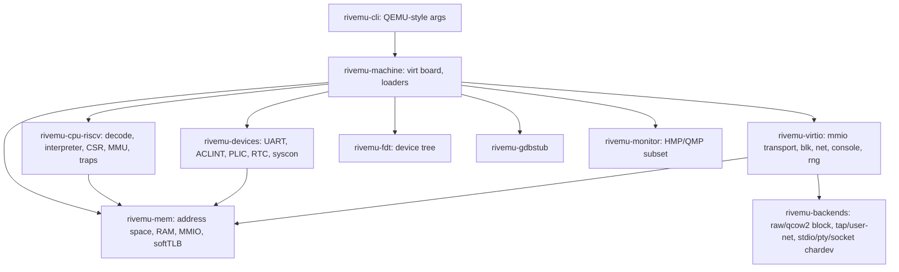

# Plan: `rivemu` – a limited, pure-Rust QEMU successor (emulation only)

## 1. Locked Decisions

| Area | Decision |
|---|---|
| Mode | Full-system emulation only (no user-mode, no KVM/HVF) |
| Guest ISA | RISC-V **RV64GC** (IMAFDC + Zicsr + Zifencei), M/S/U modes, Sv39/Sv48 |
| Host platforms | macOS arm64, Linux x86_64/arm64 |
| Execution engine | **Interpreter only** – optimised with a decoded-block cache (no JIT, no runtime codegen) |
| Machine | Single board: `virt`, memory map compatible with QEMU's `riscv64 virt` |
| Firmware | Upstream **OpenSBI** binary (`fw_dynamic`/`fw_jump`) loaded as guest firmware; emulator itself is 100% Rust |
| CLI | QEMU-compatible subset, binary name `rivemu-system-riscv64` |
| Unsafe policy | `unsafe` only in `rivemu-mem` (guest RAM host pointers / mmap) |
| Non-goals | JIT, user-mode, KVM, live migration, graphics, PCI (initially), multiple boards/ISAs |

**Success criterion:** `rivemu-system-riscv64 -M virt -nographic -bios fw_jump.bin -kernel Image -initrd rootfs.cpio -append "console=ttyS0"` boots upstream Linux to a BusyBox shell; a disk-image distro (Alpine/Debian riscv64) boots with virtio-blk root and virtio-net networking. Performance target: Linux-to-shell (initramfs) in **< 60 s** on an M-series Mac.

## 2. Architecture



### Cargo workspace
```
rivemu/ (github.com/kmehltretter82/rivemu)
  Cargo.toml                 workspace
  crates/
    rivemu-core/        GuestAddr, AccessSize, Exception/Interrupt types, virtual clock, IRQ line trait
    rivemu-mem/         AddressSpace, region map, mmap'd RAM, MmioDevice trait, dirty-page tracking
    rivemu-cpu-riscv/   decoder, instruction handlers, block cache, CSRs, MMU walker + softTLB, softfloat glue
    rivemu-devices/     ns16550a, ACLINT (mtimer/mswi/sswi), PLIC, goldfish-rtc, sifive_test/syscon
    rivemu-virtio/      virtio-mmio v2, split virtqueue; blk, net, console, rng
    rivemu-backends/    block (raw, qcow2 subset), net (tap Linux, user-net via smoltcp, vmnet later), chardev
    rivemu-fdt/         FDT builder (QEMU virt-compatible nodes)
    rivemu-gdbstub/     wrapper over `gdbstub` crate
    rivemu-monitor/     minimal HMP (stdio mux Ctrl-A) + QMP JSON (quit, stop, cont, query-status, system_powerdown)
    rivemu-machine/     virt board wiring, ELF/raw/initrd loaders, reset, main loop
    rivemu-cli/         `rivemu-system-riscv64` binary
  tests/            riscv-tests runner, Linux boot smoke tests
  images/           (gitignored) fetched kernel/OpenSBI/rootfs test artifacts + fetch script
```

### Interpreter design (performance without JIT)
- **Decoded-block cache:** guest code is decoded once into blocks of pre-decoded instructions (`enum Insn` with operand fields resolved, or a `fn` pointer + packed operands). Keyed by guest physical PC + privilege mode; ends at branches, CSR writes affecting translation, or page boundary.
- **Fast dispatch:** tight `match` over a compact op enum (Rust compiles to a jump table); hot paths like `addi`, loads/stores and branches get special-cased variants (e.g. `addi rd, x0, imm` → `Li`).
- **SoftTLB:** per-hart direct-mapped TLB (separate read/write/exec), entry stores host pointer offset → RAM access is one compare + one load. MMIO and misses take the slow path.
- **Self-modifying code:** code pages tracked in a bitmap; a store to a tracked page invalidates its blocks; `fence.i` / `sfence.vma` flush as required.
- **Interrupt checks** only at block boundaries (plus pending-flag on `wfi`/CSR writes).
- **Timekeeping:** `mtime` derived from host monotonic clock (default) or instruction count (`-icount` deterministic mode, useful for tests).

### Threading
- Phase 1: single vCPU thread runs all harts round-robin (deterministic, simple).
- Phase 2: optional thread-per-hart (MTTCG-like) with host atomics for AMO/LR-SC.
- One I/O thread with an event loop (`polling`) for chardev/net/block backends; communicates with devices through lock-protected queues + IRQ notifications.

### CLI subset (QEMU-compatible)
`-M/-machine virt`, `-m`, `-smp`, `-bios`, `-kernel`, `-initrd`, `-append`, `-dtb`, `-drive file=,format=,if=none,id=`, `-device virtio-blk-device,drive=`, `-netdev user|tap,id=`, `-device virtio-net-device,netdev=`, `-nographic`, `-serial`, `-chardev`, `-monitor`, `-qmp`, `-s`/`-gdb`, `-S`, `-d` (in_asm, int, mmu, guest_errors), `-D`, `-icount`, `-no-reboot`. Unknown options → clear error message.

## 3. Roadmap


### P0 – Skeleton (≈1 week)
- Workspace, CI (macOS arm64 + Linux x86_64): `cargo test`, `clippy -D warnings`, `rustfmt --check`, `cargo-deny`.
- `rivemu-core`, `rivemu-mem` (RAM + MMIO dispatch), ELF loader, CLI parser skeleton accepting the QEMU option syntax.
- **Exit:** address-space unit tests green; `rivemu-system-riscv64 --help` works.

### P1 – RV64GC unprivileged interpreter (≈3 weeks)
- Decoder incl. compressed (C) instructions; RV64I/M/A/F/D, Zicsr, Zifencei.
- F/D with exact IEEE semantics (rounding modes, fflags, NaN-boxing) via a pure-Rust softfloat (e.g. `simple-soft-float`/own port of Berkeley SoftFloat).
- Straightforward fetch-decode-execute first; HTIF `tohost` for test exit.
- **Exit:** all `riscv-tests` `rv64u{i,m,a,f,d,c}-p-*` pass.

### P2 – Privileged architecture & MMU (≈3 weeks)
- M/S/U modes, trap delegation, `mret/sret/wfi`, `mstatus` fields (MPRV, SUM, MXR, FS), counters, minimal PMP.
- Sv39/Sv48 walker with A/D updates, `sfence.vma`, softTLB.
- Interrupt delivery (`mip/mie/mideleg`), Sstc (`stimecmp`) for faster Linux timers.
- **Exit:** `rv64{mi,si}-p-*` and `rv64*-v-*` riscv-tests pass; riscv-arch-test privileged subset green.

### P3 – `virt` board & Linux boot (≈3 weeks)
- Devices: ns16550a, ACLINT, PLIC, sifive_test (poweroff/reboot), goldfish RTC.
- FDT generation (or `-dtb`), OpenSBI + kernel + initrd placement identical to QEMU, `a0/a1` boot protocol, fw_dynamic info struct.
- Decoded-block cache + softTLB fast paths.
- gdbstub (`-s -S`), `-d int,guest_errors` logging.
- **Exit:** upstream Linux defconfig + BusyBox initramfs boots to shell; `poweroff` and `reboot` work; boot test runs in CI.

### P4 – Virtio & host backends (≈3 weeks)
- virtio-mmio v2 transport, split virtqueues, event-idx.
- virtio-blk (raw, then qcow2 read/write subset), virtio-net (user-net via `smoltcp` with DHCP/DNS/port-forward `hostfwd`; tap on Linux), virtio-console, virtio-rng.
- Chardev backends: stdio (with Ctrl-A mux), pty, unix/tcp socket; monitor + QMP subset.
- **Exit:** Alpine/Debian riscv64 disk image boots to login, package install over network succeeds.

### P5 – Performance, SMP, polish (≈3–4 weeks, then ongoing)
- Profiling (`perf`/Instruments), op fusion in block cache, branch-target block chaining, reducing bounds checks in hot paths.
- `-smp N`: round-robin first, then thread-per-hart; IPIs via ACLINT/SBI; correct AMO/LR-SC.
- Optional: CPU+device snapshot (`savevm`-lite via `serde`), packed virtqueues, vmnet on macOS.
- **Exit:** < 60 s initramfs boot; `-smp 4` Linux boot stable; benchmark suite tracked per commit.

Total for P0–P5: roughly **4 months** for one developer.

## 4. Testing & Verification
- **Unit tests** per crate (decoder tables, CSR rules, page walks, virtqueue parsing, CLI parsing).
- **Conformance:** `riscv-tests`, `riscv-arch-test` (reference signatures from Sail/Spike).
- **Differential testing:** compare instruction traces with Spike / QEMU (`-d exec,cpu`) on small programs; `cargo-fuzz` on the decoder and single-instruction execution vs Spike.
- **Integration:** expect-style Linux boot tests in CI with prebuilt kernel/OpenSBI/rootfs fetched by `images/fetch.sh` (cached).
- **Benchmarks:** `criterion` micro-benchmarks, guest CoreMark/Dhrystone, boot-time measurement.

## 5. Dependencies (all pure Rust)
`clap` (or hand-written parser for QEMU syntax), `goblin`/`object`, `memmap2`, `gdbstub`, `vm-fdt`, `smoltcp`, `polling`, `serde`/`serde_json`, `tracing`, `thiserror`/`anyhow`, softfloat crate. Dev: `criterion`, `cargo-fuzz`.

## 6. Risks
| Risk | Mitigation |
|---|---|
| Interpreter too slow for the 60 s target | Block cache + softTLB early (P3), profile continuously, op fusion |
| FP edge cases | Softfloat for all F/D ops, arch-test coverage |
| QEMU CLI quirks (`-drive`/`-netdev` option syntax) | Dedicated parser for QEMU `key=value,...` grammar with tests from real-world scripts |
| macOS networking without root | user-net (smoltcp) as default backend; vmnet optional later |
| Scope creep | Non-goals list above; one board, one ISA |

## 7. Progress
- [x] **P0** – workspace, CI, `rivemu-core`, `rivemu-mem`, loaders, CLI skeleton
- [x] **P1** – RV64GC interpreter, `rivemu-softfloat` (exact IEEE, all rounding modes)
- [x] **P2** – M/S/U, traps/delegation, Sv39/Sv48 + TLB, Sstc; all 244 riscv-tests (`-p` and `-v`) pass
